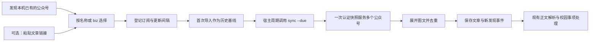

# 微信公众号本地订阅模块

Windows 上独立运行的只读采集模块。主要入口是从本机已经同步的公众号列表按名称选择，不需要提供文章链接、公众号管理员账号、微信读书或千问办公。文章链接是备用登记方式。

当前实测环境：**Windows x64，微信 4.1.15.13，2026-10-09**。依赖 Python 3.14+、PowerShell 7.5+。适配基线见 [compatibility.json](compatibility.json)，每次实际读取时检测到的版本还会记录在运行数据库里。

## 微信需要保持什么状态

| 状态 | 模块表现 |
|---|---|
| 微信已登录，在后台或最小化 | 可以读取本地已同步的公众号消息；不必打开公众号页面 |
| 关闭微信窗口，但主进程仍运行 | 只要本地读取校验通过，仍可采集 |
| 完全退出微信 | 暂停读取新数据，已有文章仍能查看；每轮调用返回等待微信运行 |
| 微信重新启动 | 下一轮重新寻找读取能力，无需用户复制密钥；跨重启的真实验收尚待完成 |
| 断网、电脑睡眠或客户端未同步 | 不保证新推送进入本机；只能处理已经到达的数据 |
| 微信升级 | 记录新版本并重新验证；结构或数据校验失败时保留旧结果并报错 |

本模块不持久化数据库密钥，因此当前同步入口需要微信进程存在。即使将来保存读取凭证，微信退出期间也不会替我们接收新的服务器推送。手机微信在线不能替代这台电脑的客户端同步。

模块的定时调用需要宿主在运行。已接入 CampusAgent 插件：应用启动后每分钟检查到期任务，每号默认间隔 120 秒；关闭插件会停止读取并取消本模块正在执行的子进程，退出应用会释放定时器。没有安装独立后台服务、开机启动项或系统计划任务。

## 可复用流程



1. **发现**：读取公众号消息库，列出可识别的名称、biz、本机文章数量和最新文章时间。只输出公众号信息，不读取个人聊天库。这个列表代表本机有可识别图文记录的公众号，不等于微信完整关注列表。
2. **选择**：支持名称、biz 或文章链接。重名要求选择具体 biz；重新添加同一个 biz 不创建重复订阅。新增一个号不需要修改采集器。
3. **首次导入**：已有文章作为基线，不逐篇产生“新推文”事件。一个推送包含多篇图文时全部展开。
4. **周期同步**：默认每号 120 秒，允许 60～86400 秒。宿主每隔 60 秒调用一次 `sync --due`，模块自行判断到期的账号。该默认值表示检查本地数据的频率，不保证公众号发文后两分钟一定可见。
5. **失败恢复**：读取失败保留文章和上次成功时间，重试间隔逐步退避，最长 30 分钟。手动 `sync` 可以立即重试。微信退出、快照校验失败和本地无数据有不同状态。
6. **下游处理**：通过 `articles` 读取文章，通过 `events --after-id` 读取新发现事件。消费者自行保存游标并按事件 ID 去重，处理成功后才推进游标。

“新发现”与“刚发布”分开。离线补齐、历史记录同步都可能出现新链接，发布时间是独立字段；早于首次基线的补入记录标为 `isBackfill`，下游不能把它误报成刚发布的新推文。

## 使用方式

在项目根目录运行。以下示例的 `python` 指向 Python 3.14+；本机已经验证的解释器是 `C:\Program Files\Python314\python.exe`。

```powershell
# 检查进程、数据位置和版本；该命令不代表密钥或在线登录已验证
python core/wechat/wechat_feed.py doctor

# 列出本机可识别的公众号，也可以不加 query 查看全部
python core/wechat/wechat_feed.py discover --query 浙大

# 主要入口：按公众号名称添加，无需文章链接
python core/wechat/wechat_feed.py add --name "浙大体育与艺术"

# 同步已登记且未暂停的公众号
python core/wechat/wechat_feed.py sync

# 宿主定时器使用：只同步到期的公众号
python core/wechat/wechat_feed.py sync --due

# 状态、历史数据、新发现事件
python core/wechat/wechat_feed.py list
python core/wechat/wechat_feed.py articles --biz "MzA3MDk5NDA0NA==" --limit 20
python core/wechat/wechat_feed.py events --after-id 0

# 暂停或恢复，不删除已保存文章
python core/wechat/wechat_feed.py pause --biz "MzA3MDk5NDA0NA=="
python core/wechat/wechat_feed.py resume --biz "MzA3MDk5NDA0NA=="
```

备用添加入口：

```powershell
python core/wechat/wechat_feed.py add --biz "MzA3MDk5NDA0NA==" --label "浙大体育与艺术"
python core/wechat/wechat_feed.py add --article-url "https://mp.weixin.qq.com/s/4qwgIC-4Fk_6Se9NvKSXYQ"
```

若本机尚无目标号的数据，可以先用链接登记身份，但还要由用户在普通微信中关注该号并让客户端收到推送。链接本身不能补出未同步的记录，也不能据此构造未来文章 URL。

所有命令输出 JSON。失败时返回非零退出码和稳定的错误代码，不透传可能含路径或凭证的底层异常。名称来自已同步推送，公众号改名后可能暂时显示旧名称；biz 是登记主键。

## 数据与接口约定

默认运行数据位于 `%APPDATA%\CampusAgent\wechat-feeds\feeds.sqlite`，不写入源码目录。可用全局参数 `--data-dir 路径` 或 `CAMPUS_WECHAT_DATA_DIR` 指定独立目录。

| 数据 | 用途 |
|---|---|
| `accounts` | 订阅、名称、是否启用、间隔、目标表缓存、首次基线、尝试与成功时间、失败状态 |
| `inventory` | 本机发现的公众号名称、biz、文章数量及来源绑定；不导入未订阅号的文章正文 |
| `articles` | 目标公众号的标题、公开原文链接、发布时间、接收时间、首次与最近发现时间 |
| `events` | 持久化的新发现事件，首次历史导入不产生通知事件 |
| `version_observations` | 各微信版本的首次与最近观察时间、最近验证成功时间、成功次数 |
| `runtime_state` | 最近检测到的后端、版本、来源标识及本次校验状态 |

文章的稳定 ID 为 `biz:mid:idx`。公开 URL 只保留 `__biz`、`mid`、`idx`、`sn`。不保存 Cookie、原生授权 URL、数据库密钥、微信全量明文数据库或个人聊天记录。

`lastSuccessfulSyncAt` 表示最近一次完整读取所覆盖本地库的时间，不是微信服务器确认同步时间；不能用它宣称“线上没有新文章”。每次结果均保留 `completeAccountFeed=false`。

### 宿主调用边界

- 用进程参数数组调用 `wechat_feed.py`，不要把公众号名称拼接成 shell 命令。
- 单轮同步获取一次快照、验证一次数据库，再分别输出多个目标号的数据。定位过的公众号优先只查询其表。
- SQLite 写事务阻止同时更新同一份状态。遇到 `busy` 下次再试，不能启动重叠扫描。
- 页面可以直接读取缓存；用户打开插件页不必触发一次微信扫描。
- `events` 游标由正文解析模块维护。解析失败不推进游标，重试按 `eventId` 去重。
- 文章链接交给现有正文提取；内容摘要、报名截止等属于下游模块，不塞进本地读取器。
- 用户关闭宿主时停止其定时器。若以后要在宿主退出后继续采集，再独立实现后台进程生命周期；当前未部署。

### 页面状态建议

| 状态 | 用户可见文案 |
|---|---|
| `pending` | 等待首次导入 |
| `synced_local_cache` | 本地读取成功，同时显示文章最新发布时间和上次检查时间 |
| `waiting_for_local_messages` | 本机暂无该公众号图文，请等待微信同步 |
| `wechat_not_running` | 等待微信运行，已有文章仍可查看 |
| `partial_local_read` | 读取不完整，已有结果保留 |
| `wechat_session_or_version_unavailable` | 当前微信登录状态或版本无法验证 |
| `snapshot_verification_failed` | 本地数据校验失败，将稍后重试 |
| `wechat_account_changed` | 微信账号来源已变化，请切回原账号；不自动混合数据 |
| `paused` | 已暂停 |

## 版本适配

版本号只用于识别适配环境，不是密钥。密钥与账号、具体数据库有关；升级也可能改变结构或内存中的编码方式。当前后端先匹配目标数据库 salt 对应的运行时上下文，再验证密钥及每一页 HMAC，最后检查内存 SQLite 完整性。任何一环失败均不输出伪成功。

已验证基线固定保存为 `4.1.15.13`；运行日志另外记录实际检测值，两者不相互覆盖。成功发现列表或同步时保存验证记录；能检测版本但读取失败时也记录该版本及未验证状态。未知版本仍须通过同样的逐页校验，不能凭复用旧偏移或版本字符串跳过认证。

升级后的验收至少包括：按名称发现与添加、首次导入、多篇图文、重复同步、WAL 提交边界、校验失败保留旧结果、一次真实新推送、退出与重启恢复。2026-10-09 已从原有 79 篇基线增量发现第 80 篇，识别为 1 条新发现事件，并在插件界面显示；尚未测量发布到本机同步的延迟，也未做跨微信重启验证。

当前仅支持一个明确的本地微信资料目录、一个主进程和 `biz_message_0.db`。发现额外公众号分片会标注读取不完整；多个本地账号不自动挑选。后续通过新增后端适配器扩展，不改变上层文章和事件协议。

## 验证记录

- 本机 4.1.15.13 已无需文章链接发现公众号名称，并按名称添加「浙大体育与艺术」。
- 导入该号 40 条推送展开的 79 篇文章，使用新的独立目录及运行数据库。
- `python core/wechat/test_feed.py` 的 7 组测试覆盖无链接添加、多账号共用快照、去重事件及游标、退出状态与恢复、暂停和到期判断、来源切换隔离、失败版本记录及公开链接脱敏。
- 原研究阶段另有由原生 SQLite 生成的 WAL 提交、未提交、旧尾部和篡改拒绝测试；验证过的快照组件已移入本模块。
- 后端读取不操作微信界面，不重启客户端、不注入进程、不修改代理或证书。

代码结构：`wechat_feed.py` 管理订阅、状态和事件；`backend/read-local.ps1` 负责只读本地桥接；`runtime-key.cs` 与 `snapshot.cs` 负责运行时校验和内存快照；`metadata.py` 解析、发现公众号并分发目标图文。模块不依赖 `计划/` 下的原始研究脚本。

## 已接入的应用接口

`ui/profile/catalog.mjs` 的 `LOCAL_PLUGINS` 登记 `campus.wechat`，与 ZJU Core 的 `CAMPUS_PLUGINS` 分开，通过 `APP_PLUGINS` 统一呈现。开关仍保存于现有 `plugins.json`，不会往 `ZJU_DISABLED_MODULES` 中塞入虚构模块。

`ui/profile/wechat.mjs` 是唯一应用服务，统一处理进程参数、超时、并发、开关检查和停止。数据目录随应用 profile 的根目录隔离，独立窗口测试不会写到真实订阅库；打包后仍需本机具有 Python 3.14+ 和 PowerShell 7.5+，缺少运行时会显示错误而非空列表。

页面复用 `/api/campus/profile` 的 JSON 协议，动作包括 `wechat-read`、`wechat-check`、`wechat-discover`、`wechat-add`、`wechat-set`、`wechat-refresh`、`wechat-articles`。助手通过 `campus_wechat_read` 读取已添加号的文章与状态，可以按名称筛选。页面 API 和助手工具都在服务侧检查开关；派生 shell 命令也接收 `CAMPUS_WECHAT_DISABLED`。

`ui/client/WechatSettings.tsx` 嵌入现有插件详情，复用图标框、开关、分组、列表、输入框、菜单、Modal、Toast 和错误条。支持本地名称搜索、链接备用添加、重复登记判断、单号暂停恢复、手动刷新、按号筛选文章、打开原文，以及微信状态和实际版本展示。关闭整个插件时停止同步并禁用读取入口，缓存不删除。交互和视觉验收见 [UI-QA.md](UI-QA.md)。
