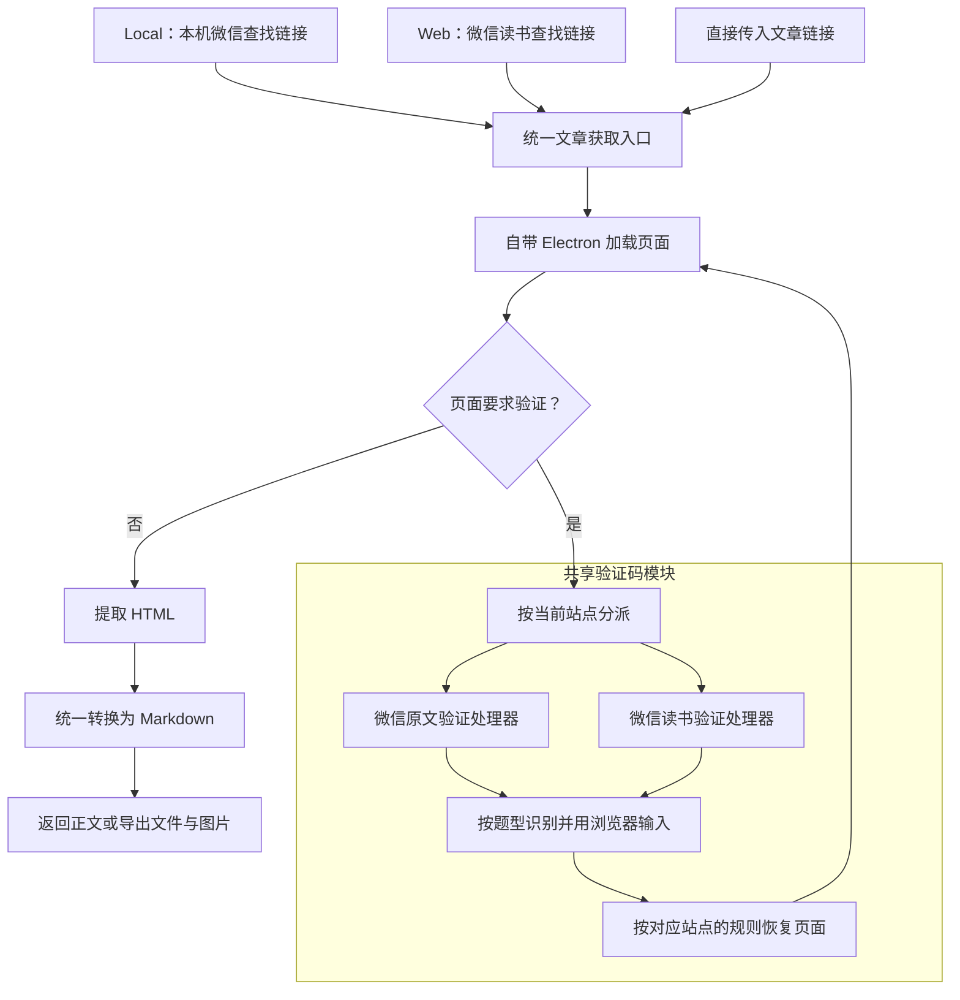

# WeRead Skill

> 校园智能体里的这一份是 2026-10-11 从 WeRead Skill 的 56d17bd 复制过来的，之后在这里单独改，不和原仓库同步。为应用加了什么、和原仓库差在哪，见项目根目录 README 的「微信公众号」；应用里浏览器由壳提供，下面「开始使用」讲的自己装 Electron 是它独立使用时的做法。

查询和跟踪微信公众号文章，用自带浏览器读取正文，导出 Markdown 和图片。提供一个统一 CLI，也可由支持 Skill 的智能体按 [SKILL.md](SKILL.md) 调用。

Local 从本机微信消息中查找文章，Web 从微信读书查找文章。两种来源只负责找到链接；链接进入统一的浏览器取文流程，遇到验证码时再按站点和题型处理。

## 开始使用

需要 Node.js 24+。在项目目录安装依赖，会同时安装固定版本的 Electron 44.0.0，无需系统 Edge/Chrome 或其他应用提供浏览器。Electron 是可选依赖：由别的应用提供浏览器时（见 [架构与接口](dev/architecture.md#被应用托管)）用 `npm install --omit=optional` 跳过它。

```sh
npm install
node scripts/weread.ts --help
```

使用 Local 来源时，需要 Windows、保持登录运行的电脑版微信、系统 PowerShell 5.1 和 Python 3.14+。目前已实测微信 4.1.15.13。Web 来源不需要本机微信和 Python，但需要登录微信读书。

```sh
# 从本机微信查找文章
node scripts/weread.ts list --account "公众号名称" --source local --limit 10

# 按公众号和标题下载，不必先执行 list 或 read
node scripts/weread.ts download --account "公众号名称" --title "文章标题" --source local --out ./downloads

# 使用微信读书来源前，在自带窗口扫码登录
node scripts/weread.ts login
node scripts/weread.ts list --account "公众号名称" --source web --limit 10

# 也可以直接读取微信原文链接，或 list 返回的微信读书链接
node scripts/weread.ts read --url "文章链接"
```

如需自动识别验证码，参考 [.env.example](.env.example) 在项目根目录配置 `.env`。没有配置识别模型时，免交互验证仍由页面自动完成，需要答题则显示窗口等待用户操作。配置项和数据目录见 [运行说明](references/runtime.md)。

## 命令

以下参数接在 `node scripts/weread.ts` 后面。业务结果和错误均输出 JSON，帮助信息用 `--help` 查看。

| 命令 | 用途 |
|---|---|
| `login` | 登录微信读书；加 `--check` 只看有没有登录记录，不开窗口 |
| `logout` | 退出微信读书，清掉自带浏览器里的登录状态 |
| `accounts [--query 名称]` | 按名称找公众号的候选；不带名称时列出来源里现有的公众号 |
| `list --account 名称 [--limit 数量]` | 列出公众号最近的文章，默认 20 篇；不带 `--account` 时列出跟踪名单里每个号的，只看不记 |
| `read --url 链接` | 返回文章信息及 Markdown 正文 |
| `download --url 链接 --out 目录` | 保存 Markdown，并下载正文图片 |
| `track --account 名称` | 开始跟踪；不带参数查看名单，加 `--cancel` 停止跟踪 |
| `new [--account 名称]` | 检查跟踪名单中的新文章 |

`read` 和 `download` 也接受 `--account 名称 --title 标题`，与 `--url` 二选一。名称和标题支持部分匹配；匹配到多个时返回候选，需要写得更完整。

`--source local|web` 决定查找链接的来源，优先于 `.env` 中的 `WEREAD_SOURCE`。两者都没设置时先 Local，来源不可用或没找到文章再尝试 Web；名称有歧义时不切换。拿到链接以后，正文或验证码失败直接报错，不再换来源重查。

下载结果保存为 `目录/标题-链接哈希/标题.md`，图片在同级 `images/`，Markdown 使用相对路径。下载失败的图片保留远程链接，结果中的 `images.failed` 列出失败项。跟踪按来源分别记录已见文章，首次使用某个来源检查时只建立基线。

## 架构

多个来源先汇合到统一文章入口，再由共享验证码模块按页面分派处理。链接保留原站点，各站使用自己的验证入口和回执恢复方式，题型识别与浏览器输入共用。



图中展示文章取文流程。微信读书列表请求遇到验证码时，也调用同一共享模块，通过后重发当前列表请求。免交互验证无需调用识别模型。

| 模块 | 职责 |
|---|---|
| `lib/local.ts`、`lib/web.ts` | 查找公众号、文章列表和链接 |
| `lib/sources.ts` | 选择来源、查找回退和跟踪名单 |
| `lib/article.ts`、`lib/article/page.mjs` | 统一加载文章、调用验证处理、解析与导出 |
| `lib/captcha/` | 站点验证处理器、题型适配与识别模型调用 |
| `lib/browser/` | 会话、窗口和登录（service.cjs），自带 Electron 的入口，以及连到宿主应用的通信 |

详细的接口、回执绑定和宿主复用边界见 [架构与接口](dev/architecture.md)。

## 当前验证范围

截至 2026-10-12，类型检查和 46 项自动测试通过，其中包含真实 Electron 与合成页面的集成测试。

| 能力 | 本轮实测 |
|---|---|
| Local 查找、浏览器读取、Markdown 与图片导出 | 已通过；原文免交互验证后取得正文，26/26 图片保存成功 |
| Web 列表、微信读书链接经统一浏览器读取 | 已分别通过 |
| Web 查找、正文与图片导出 | 已通过；正式会话续期后保存 Markdown 和 4/4 图片，浏览器退出后新命令仍能读取正文 |
| 原文交互题自动作答至恢复正文 | 尚缺本轮线上样本 |

2026-10-12 已修复隐藏验证时的页面初始化冲突：微信读书首页会延迟移动页面节点，提前插入的验证码 iframe 会被重载；现在等首页滚动条组件初始化完成后再启动验证。原文免交互、微信读书六图验证、取文及图片导出均已有全程隐藏的成功样本。配置了识别模型时自动验证保持后台运行，扫码登录或未配置识别模型时才显示窗口。其他题型的隐藏模式仍需补充线上样本；这里使用隐藏 Electron 窗口，不是 Headless 浏览器。

共享题型实现包含六图/九宫格选图、文字和图形顺序点选、单拼块滑块、语音数字；这些实现和离线测试不代表所有站点、所有题型都已在线上通过。完整证据和待验收事项见 [验证依据](dev/verification.md)。当前不支持 `/web/reader/…` 阅读页链接，请使用微信原文链接或 `list` 返回的链接。

## 开发与文档

```sh
npm run typecheck
npm test
```

Skill 可以独立使用，也可以由应用托管：应用用自己的 Electron 提供浏览器，命令照常执行。凭据、密钥和个人数据库不进入源码或日志。

- [SKILL.md](SKILL.md)：智能体调用约定与命令用法。
- [运行说明](references/runtime.md)：运行环境、配置、会话与错误处理。
- [开发约定](AGENTS.md) · [当前计划](dev/PLAN.md) · [架构与接口](dev/architecture.md) · [验证依据](dev/verification.md)。
- [历史调研与验收](dev/history/)：旧实现、实验和阶段证据，按各文档注明的时间理解。
- [第三方声明](THIRD_PARTY_NOTICES.txt) · [腾讯相关许可](dev/Tencent-LICENSE)。
