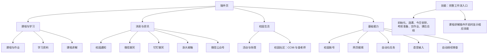
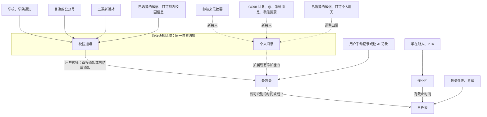

# 插件分类与消息页面改造 Plan

日期：2026-10-18（Asia/Taipei）  
状态：方案已由用户确认；2026-10-19 已按本 Plan 实现，执行记录见第 11 节。同日补了邮箱和 CC98 的后台检查与托盘提醒，并在源码起的桌面应用里用示例数据走查过（第 11 节末尾）；装好的应用、真实新消息到来时的托盘提醒尚未走查。  
工作目录：`D:\Innovation`

## 1. 执行目标与最终决定

在现有校园智能体上完成三个部分：插件分类、消息接入与归属、校园事务页面调整。沿用现有模块和已连通的数据路径，按本计划分步实现并验收。

用户最后确认的要求优先于此前讨论中的设想：

1. 插件按用途分为少量类别，本方案为 **4 类**。分类是设置页的组织方式，各插件仍有独立开关、账号、权限和运行逻辑。
2. 校园事务保持 **左侧作业及备忘录、右侧通知**。右侧只有一块内容区域，通过 **校园通知 / 个人消息** 两个页签切换。
3. **CC98 和邮箱继续接入“个人消息”。** 用户说它们不该并入校园通知，是在区分两个页签，并未要求移除这两个消息源。不要删掉个人消息页签。
4. 微信、钉钉群里的主要内容是学校活动、讲座、比赛、报名和公告，很多只在群里发布。它们与二课、学校官网、公众号的校园信息并列展示，不能预设为课程作业信息。
5. **筛选按钮与两个页签放在同一行。** 小面板紧贴按钮弹出，不能按钮在标题栏、选项隔着页签在下一层展开。
6. 延续“用户选择通知 → 直接添加或总结后添加到备忘录 → 有时间字段则进入日程”。作业、课表和考试维持各自直达日程的路径。
7. 不建设“所有来源先汇总、再统一语义处理、再发散到所有页面”的新架构。首期不做跨平台活动语义合并、全局事件总线或全新事项数据库。

执行前读取当前 `AGENTS.md` 和涉及模块的开发约定。工作区存在其他 AI 的并行修改，先检查当前内容；只修改本任务相关部分。日程前端由另一个 AI 负责，本任务复用现有接口，不重做其页面。

## 2. 可查看的页面方案

- [可直接打开的交互草图](plugin-pages/页面方案.html)
- [交互草图源文件](plugin-pages/页面方案.fragment.html)

草图可切换校园事务和插件分类页，切换通知页签，筛选来源和时间，查看通知详情，添加或打开备忘录。

草图中的姓名、活动、作业、时间、数量均为**示例内容**，不能带入正式应用或用户档案。草图不连接真实账号，也不代表新消息源已接通。正式实现复用项目现有 React 组件、主题和共享控件，不把草图作为一个独立网站嵌入应用。

草图没有实现所有生产控件；已有插件配置、开关、作业操作、备忘录编辑、全部时间筛选等能力要保留。筛选弹窗可以使用现有 `Menu` 等控件实现，重点遵守位置、层级和交互要求。

## 3. 插件分类架构



### 分类与现有标识对应

| 类别 | 保留的插件 | 现有 ID |
|---|---|---|
| 课程与学习 | 课程与作业、学习资料、课程讲解 | `campus.courses`、`campus.materials`、`campus.learn` |
| 消息与资讯 | 校园通知、微信聊天、钉钉聊天、浙大邮箱、微信公众号 | `campus.notices`、`campus.wechat-chat`、`campus.dingtalk`、`campus.mail`、`campus.wechat` |
| 校园生活 | 活动与场馆、校园社区 | `campus.activities`、`campus.community` |
| 基础能力 | 校园账号、网页搜索、自动化任务、语音输入、自动授权审查 | `campus.account`、`web-search`、`automation`、`voice`、`auto-review` |

- 微信与钉钉是两个插件，不能为了分类合成一个配置项。
- CC98 仍位于现有“校园社区”插件，消息显示到个人消息页签不要求拆插件。
- 保留校园账号的基础项特性，以及所有插件现有默认启用/关闭状态。
- 技能单独展示，不能混成第 5 类插件。“比较老师”仍是选课技能的内部步骤。
- 一个插件只在一个类别中出现；分类信息尽量由一份元数据提供，避免多处手写列表。

## 4. 消息架构与现有连线

图中实线表示沿用的来源和功能路径；虚线表示新增接入、归属调整。右侧通知的两个页签是本次页面改造，原来的单列表需要改成按页签取数和展示。



### 归属规则

| 内容 | 首期归属 | 说明 |
|---|---|---|
| 学校、学院公告，公众号校园信息，二课新活动 | 校园通知 | 沿用现有筛选与原文入口 |
| 微信、钉钉群内学校活动、讲座、比赛、报名和群公告 | 校园通知 | 群名和发布者作为来源，不要求关联课程才能显示 |
| 用户已经选择关注的个人聊天 | 个人消息 | 通过聊天类型和既有配置确定，不扫描未选择的聊天 |
| 邮箱来信 | 个人消息 | 首期保留在此页签，不另做邮件内容的自动跨页签分类 |
| CC98 回复、@、系统消息、私信摘要 | 个人消息 | 限本人消息，论坛十大、全站帖子不自动灌入 |
| 平台上的作业 | 作业栏 | 不为每份作业额外复制通知和备忘录 |
| 课件、录播和学习资源 | 学习页 | 本期不把资源列表全部推入通知 |

首期按可靠的来源类别、聊天类型和已选择范围完成归属，不要求对所有消息做新的 AI 分类。群内是否直接针对本人、是否涉及某份作业，属于后续局部关联能力；拿不准时保持原文和原归属。

Profile 可提供已有、已确认的课程或群关系，但不作为所有通知的必经入口；读普通校园活动无需先完成初始化。

### 当前已经具备的能力

- `Feed` 已混合学校通知、公众号、二课活动、微信/钉钉监控缓存。
- `ChatWatch` 已支持选择会话、发送者、同步间隔，以及原样收集或 AI 整理；有新消息去重及失败保留原文。
- `NoticeMemo` 已支持直接添加、总结后添加、相同来源重复添加检查。
- 日程已读取作业和备忘录的时间字段。交接时 `host.mjs` 已使用 `affairs.tasks()` 和 `affairs.refreshAll()` 提供作业及刷新能力，不能用早期方案中的旧接线覆盖它。
- 邮箱查询、正文读取、附件下载、草稿和授权发送已经可用，但尚未进入通知列表。
- CC98 本人消息查询已经可用，但尚未接入通知页的持续展示。

## 5. 校园事务页面设计

### 布局

```text
侧栏              校园事务
                  ┌────────────────┬───────────────────────────┐
新会话            │ 作业           │ 通知                      │
插件              │ 平台作业列表   │ 校园通知  个人消息  筛选⌄ │
日程表            │                │ ────────────────────────  │
校园事务          │ 备忘录         │ 标题                      │
学习              │ 用户记录       │ 关键时间                  │
                  │ 从通知保存的事 │ 来源、群名、发布者     ＋ │
                  │                │ ……                        │
                  └────────────────┴───────────────────────────┘
```

- 左边保留作业和备忘录；右边仍只使用一块通知区域。
- 桌面宽度允许时，右栏可略宽以容纳标题；保持现有主题和整体风格。
- 窄窗口沿用响应式堆叠，不再挤出第三栏，不出现水平溢出。
- 插件分类页改变分组，不增加新的应用一级页面。

### 通知列表

- 默认“校园通知”，另一页签为“个人消息”。切换时仅替换右栏内容。
- 一条显示标题、已有的关键时间提示、来源和发布者/群名、发布时间、添加备忘录操作。未读用轻量标记表示。
- 长正文、完整聊天、报名方法、附件放到详情中；不要把整段 AI 总结塞进列表。
- 默认展示有限条目，提供“查看更多/展开其余”；按实际窗口容纳能力设置密度。新增来源不新增固定分栏。
- 原有“一周内/全部时间”等能力保留；不得把草图的 8 条示例或 5 条初始展示误当成后台总量上限。
- 页签数量使用明确、一致的口径。草图数字是条目数量，不是未读数量；筛选后数量和空状态要能解释。
- 每条仍保留来源。只做可靠标识层面的去重；跨平台仅标题相似不能强行合并。

### 筛选位置与交互：本轮用户明确修正点

1. 筛选按钮在“校园通知 / 个人消息”同一行的右侧。
2. 面板锚定按钮，紧邻其下缘展开，优先右对齐；不要隔着页签在更下方插入一整行表单。
3. 面板覆盖在列表上层，不挤动或重排下方列表；深浅主题均需不透明、可读。
4. 按钮使用现有平面控件风格，不额外加灰底大块或立体效果。
5. 来源选项随当前页签变化。校园通知不出现邮箱和 CC98 选项；个人消息显示实际已启用、可用的相应来源。
6. 选择后更新当前页签列表；切换页签时清除不适用的来源条件。
7. 提供完成/收起动作；支持点外部、Esc 关闭。Esc 关闭后焦点回到触发按钮，键盘可操作。
8. 弹出面板在窄窗口不越界。关闭面板不能吞掉用户随后点击通知或切换页签的操作。

### 详情与备忘录

- 通知详情在右栏原位展示，左侧作业和备忘录保持可见；提供返回当前列表。
- 显示来源、完整可读内容、可核实的时间地点，以及已有的原文/附件入口。读取不全时说明实际范围。
- 对学校网页等已有的原文打开方式保留可用入口，按来源复用已有阅读能力。
- 添加备忘录后，左侧更新并提示；原通知保留，添加按钮变成已保存/查看备忘录。
- 同一条反复添加不得产生重复备忘录。直接添加与 AI 总结后添加这两种能力都要保留。
- 收藏通知不等于已报名，读过通知不等于完成任务；没有明确时间不自动制造日程。
- 邮件撰写和回复继续由 AI 对话完成，邮箱插件设置页仍只负责连接。草图中的阅读区域不扩展为邮件编辑器。

## 6. 新消息源接入要求

扩展现有通知读取、缓存、详情和备忘录路径。新增来源拥有各自进度和失败状态即可，不引入全局语义汇总步骤。

### 邮箱

- 复用 `Mail.list()`、`Mail.read()` 和附件能力；新增“个人消息”的邮箱条目适配及增量同步状态。
- 列表先读取主题、发件人、时间、邮件标识；正文和附件按用户打开或要求总结时读取。
- 标识要包含账号范围、目录、`uidValidity`、`uid`。目录变化后重新验证，不能打开错信。
- 不能只靠“未读”、发件人给出的日期、第一页或主题文本判断新邮件；分页和多于一页的新来信必须处理。
- 同步保持邮箱服务器未读状态。应用里的“看过这条通知”和邮箱的已读标记分开。
- 首次建立基线，不把全部历史邮件当成刚收到的提醒；展示最近邮件与新消息判断分别处理。
- 插件关闭、账号切换、认证失败时沿用现有隔离与停止规则，保留可说明的失败状态。

### CC98

- 复用 `cc98 account notifications` 的回复、@、系统消息和私信摘要能力。
- 后台同步不能用 `private-message list/view` 拉完整会话：现有接口在读会话时会将私信标已读。后台只取不会标已读的摘要；用户明确打开对话时再按现有阅读能力处理。
- 当前私信摘要每个会话只给最新一条，不能宣称已经导入完整历史。展示范围与接口返回保持一致。
- 检查分页、各类消息以及多账号隔离。当前业务输出部分平台标识被整理掉，接入前核对原始字段，必要时在 CLI 返回中保留可靠标识和精确时间，避免只用标题/分钟时间去重。
- 不自动采集十大、全站帖子或所有关注版面；本期只接本人消息。

### 同步默认建议与共性要求

这些是执行默认值，可依据现有生命周期合理实现，不是已完成的功能：

- 沿用页面打开、回到页面和手动刷新的触发；若添加后台检查，复用插件生命周期及有界间隔，避免又创建一份定时任务。
- 消息到列表与托盘主动提醒分开；不能把首次历史加载变成一连串提醒。
- 个人消息不经过现有“按学院、年级判断是否有关”的公共通知过滤器，防止老师来信、论坛回复被错误收起。
- 扩展详情和备忘录时，用来源专属引用保留回读路径；没有网页 URL 的消息不伪造链接。
- 多来源部分失败时其他结果照常显示；分页/同步未完成不能悄悄推进到会漏消息的位置。
- 禁止将账号密码、授权码、Cookie 写入通知、备忘录、Plan、日志或测试样例。正文视为外部资料，不授予发送或提交权限。

## 7. 建议修改位置

以执行时最新代码为准；以下是定位入口，不要求机械照抄结构。

| 部分 | 代码入口 |
|---|---|
| 校园与本地插件元数据、开关 | `ui/profile/catalog.mjs`、`catalog.d.mts`、`plugins.mjs` |
| 通用插件元数据、分类渲染 | `ui/client/pluginCatalog.ts`、`PluginsPage.tsx` |
| 校园事务双栏、通知视图 | `ui/client/AffairsPage.tsx`、`Feed.tsx`、`NoticeContent.tsx`、`style.css` |
| 通知聚合与来源状态 | `ui/profile/feed.mjs`、`chat-watch.mjs`、`notice-filter.mjs` |
| 原文阅读、加入备忘录 | `ui/profile/notice-content.mjs`、`notice-memo.mjs`、`ui/client/Memos.tsx` |
| 邮箱能力 | `ui/profile/mail.mjs`、`mail-tools.mjs`；连接界面 `MailSettings.tsx` |
| CC98 能力 | `core/zju/lib/cc98/index.ts`、`api.ts`、`cli.ts`，以及对应参考文档 |
| 组装、页面 API、生命周期 | `ui/profile/host.mjs` |
| 现有日程和档案衔接 | `ui/profile/schedule.mjs`、`calendar.mjs`、`context*.mjs`；本期以复用为主 |
| 技能展示 | `ui/profile/skills.mjs`、`flow-notes.mjs`、`ui/client/Skills.tsx`；保留之前完成的归并 |

## 8. 实施顺序

- [x] **A. 对照当前实现。** 阅读相关文件与并行修改，列清实际差异，保留所有已有账号、插件配置、备忘录和监控名单。
- [x] **B. 插件分类。** 接入 4 个类别，验证所有现有插件各出现一次，开关和配置行为不变，技能仍单独展示。
- [x] **C. 校园事务布局。** 加两个页签；把筛选放在同排并锚定弹出；按视图筛选来源；详情原位显示。没有接入的数据源显示真实空/未连接状态，不填假数据。
- [x] **D. 已有聊天归属。** 复用监控范围与群/个人类型，保留原文/AI 整理模式。群内学校活动能直接进入校园通知，无需关联作业。
- [x] **E. 邮箱接入。** 增量获取、可靠去重、列表与正文、加入备忘录、错误与账号切换处理。
- [x] **F. CC98 接入。** 本人消息摘要、标识及分页、详情与备忘录；验证后台检查不改变私信已读状态。
- [x] **G. 串联回归。** 新旧通知都能按用户选择进入备忘录；有效时间继续被既有日程消费；作业到日程的直接路径不回退。
- [x] **H. UI 实测与交付。** 用隔离测试档案完成下面验收，更新本 Plan 完成情况及实际验证结果。

2026-10-19 执行完 A–H，结果和没验证到的部分见第 11 节。

## 9. 验收标准

### 页面与归属

- [x] 插件为 4 类；微信、钉钉保留独立项，校园社区仍可配置 CC98；没有重复或丢失插件。
- [x] 校园事务保持双栏结构；右栏两个页签原位切换，不增加“二课栏、微信栏、钉钉栏、邮箱栏”等固定区域。
- [x] 只有钉钉群发布的校园活动，照样出现在校园通知；不因为没有课程档案而被排除。
- [x] 邮箱和 CC98 出现在个人消息；校园通知的筛选菜单不出现这两个来源。
- [x] 筛选按钮与页签同排；面板紧贴按钮，覆盖显示而不挤动列表；完成、点外部、Esc、键盘焦点均正确。
- [x] 左右栏目在窄窗口、深浅主题、长标题、空列表、展开更多和详情状态下均不溢出。
- [x] 点击通知详情后左栏保留，返回仍在正确页签；加入备忘录后左栏更新且重复保存不重复建条目。

### 来源与已有功能

- [x] 邮箱一次新增超过一页时不漏；服务器未读状态不被后台刷新改变；目录标识重置不会打开错信。
- [x] CC98 回复、@、系统消息、私信摘要分别可用；后台检查不调用会标已读的私信全文接口。
- [x] 重复刷新不重复插入；账号切换和插件关闭不泄露旧账号内容；部分来源失败不会抹掉其他来源。
- [x] AI 整理失败保留原文，用户选择的原样模式仍可用；不新增未经选择的聊天范围。
- [x] 旧备忘录、来源引用、时间字段仍可用；实际来源原文可追溯。
- [x] 作业栏、作业详情、备忘录编辑、教务日程、现有自动化和技能入口没有回退。

### 验证方式

优先针对来源新增、分页去重、账号隔离和备忘录串联编写行为测试；不要仅用文案或布局类名断言代替验收。

按修改范围运行现有相关测试，再完成 `npm run verify` 和 `npm run ui`。实际界面检查至少覆盖：插件分类、两个通知页签、筛选面板位置、通知详情、添加/重复添加备忘录、空/失败状态、窄窗口及深浅主题。

使用隔离应用数据和合成消息验证写入；不要在验收中发送真实邮件、回复私信、报名活动或提交作业。真实账号只在所需且已授权范围内核对读取能力。

## 10. 留到后续的事项

以下曾讨论过，但不是本轮已确认页面改造的前置条件，不要顺手扩成另一个大项目：

- 全平台同一活动的自动语义归并。
- 群消息自动更新课程作业截止时间。
- 新建完整项目、社团、联系人关系网络或重构所有 Profile。
- 已报名二课活动、场馆预约新增直接进入日程的来源。
- 大规模读取附件、全部邮箱历史、所有聊天，或新增全局消息数据库。

后续可按实际需求逐条补连接。当前任务先把已有页面、正确归属、两项新个人消息源及既有备忘录路径做好。

## 11. 执行记录（2026-10-19）

### 改了什么

- **插件分类**：四类写在 `ui/client/pluginCatalog.ts` 的 `PLUGIN_GROUPS`（只列编号，一个插件只在一类），`PluginsPage.tsx` 按它分组；技能仍单独一组。开关、账号、默认开关未变。聊天、邮箱、校园社区的说明改成写清消息进哪个页签。`core/zju/references/schedule.md` 里「通用工具」改成「基础能力」。
- **页签归属**：`feed.mjs` 给每条加 `view`（`viewOf`）：学校通知、公众号、二课和群聊在校园通知，私聊、邮箱、CC98 在个人消息；聊天类型取监控名单里的 `kind`（`chat-watch.mjs` 的 `notices()` 带上 `chatKind`），说不清的留在校园通知。只有学校通知、公众号、二课过「关系不大」的筛。
- **邮箱**：`mail.mjs` 新增只读的 `inbox`（按 UID 增量、UIDVALIDITY 校验、分批、首次基线）和 `idle`；`ui/profile/mail-feed.mjs` 管进度和账号隔离，缓存 `cache/mail-feed.json`。
- **CC98**：`core/zju/lib/cc98/index.ts` 的 `account notifications` 每条加平台编号 `id`、精确时间 `at`，私信摘要加 `userId`（参考文档同步）；`ui/profile/cc98-feed.mjs` 按账号增量、翻页、去重，只用这一条命令，不碰 `private-message`。缓存 `cache/cc98-feed.json`。
- **页面**：`Feed.tsx` 改成两个页签 + 同排「筛选」+ 锚定弹出面板（自写，不用 `Menu`，以满足贴着按钮、点外面不吞点击、Esc 回焦点）；默认 8 条，其余展开，仍在原来的定高框里滚动；详情改为右栏原位（`NoticeContent.tsx` 的 `NoticeDetail`，取代原来的弹窗）。页签、筛选、点开的那一条记在模块状态里，打开备忘录再回来不丢。右栏 0.9 : 1.1。
- **详情与备忘录**：`notice-content.mjs` 按来源读：学校通知 `notice view`（读不全说明范围、给附件和原文）、邮件只读读正文和附件（附件可下载并打开文件夹）、聊天和 CC98 用已有原文；`notice-memo.mjs` 支持邮件和 CC98，没有网页链接的用 `<!-- notice:编号 -->` 认重复、保留回读路径，CC98 一律按编号认；`Notes.tsx` 渲染时不显示 HTML 注释（原来聊天加进来的备忘会把这一行显示出来）。
- **组装**：`host.mjs` 接上 `MailFeed`、`Cc98Feed`、`feed-attachment`；CC98 排在学校通知、二课之后顺序读（都经 WebVPN），邮箱并行。
- **说明**：`README.md`（校园事务「两个页签」一节、校园插件、浙大邮箱、聊天）、`core/AGENT.md`、`core/wechat/SKILL.md`、`core/dingtalk/SKILL.md`。

### 验证

- 新增行为测试：`mail-feed.test.mjs` 4 项（首次基线、n:* 带回的旧邮件不重复、一次 450 封分 3 批取完不漏、UIDVALIDITY 变化后重建且旧编号读不到、关插件/断开/换账号不泄露、认证失败保留原条目并说明）；`cc98-feed.test.mjs` 4 项（各类成行、缺编号不收、私信不编链接、基线后翻页不漏、重复刷新不重复、超过 80 条明说、中途出错下一趟补上、多账号与删除账号、插件关/账号缺不读）；`feed.test.mjs` 2 项；`notice-content.test.mjs` 3 项；`notice-memo.test.mjs` 2 项；`chat-watch.test.mjs` 1 项；`ui/client/pluginCatalog.test.mjs` 2 项。
- `npm run verify`：类型检查全过，435 项测试全过；`npm run ui` 构建通过。
- 界面：隔离数据目录 + 合成通知、群聊/私聊、邮件、CC98 消息（各来源记成刚读过，不联网），只起引擎、在浏览器里看。看过：插件四类与开关、技能单列；两个页签与数字（校园通知 9、个人消息 6）；只由钉钉群发的活动出现在校园通知；两个页签的来源选项各不相同（校园通知无邮箱、CC98）；面板贴按钮下沿靠右、覆盖列表、不透明；选来源后列表与「只看…」一行更新；Esc、「完成」后焦点回到按钮；面板开着时直接点页签一次切换并清掉来源；点外面关闭；邮件、CC98、私聊详情原位显示，返回仍在个人消息；邮件读不到（测试环境无安全存储）时显示原因和重试；从详情直接加到备忘录后左栏更新、按钮变「查看备忘录」、列表行变成勾；备忘录里不再显示编号行；关掉浙大邮箱和校园社区后条目消失并说明「在插件页关着」；深色主题；760px、420px 宽无横向溢出、面板不越界。

### 没有验证 / 留意

- **CC98 真实账号（2026-10-19，用户授权只读）**：在复制出来的隔离档案里跑了应用的 `Cc98Feed` 两趟。核对前后各读一次未读计数（`account overview`），都是回复 0、@ 0、系统 0、私信 0，没有变化；因为没有未读私信，命令也没有去读最近联系人，没有打开任何私信。基线收进回复 20 条、系统消息 20 条（这个账号没有 @），每条都有整数 `id` 和精确到毫秒的 `at`（如 `2026-10-15T04:06:45.047Z`，`time` 仍是分钟），40 条编号互不相同；强制再刷一趟仍是 40 条、没有重复、没有报错。只打印了条数和字段形状，没有看内容。**没覆盖到**：私信摘要那一组（账号上没有未读私信）、@ 那一组、基线之后真有新消息时的翻页（只在自动测试里核过）。
- **浙大邮箱真实账号（2026-10-19，用户授权只读）**：第一次没核成：档案里原来那份专用密码用本机 CampusAgent 数据目录的安全存储密钥解不开（密钥本身往返测试正常），多半是在另一份数据目录下连接后留下的，应用自己读也会报安全存储的错。用户在应用里重新生成专用密码、重新连接以后，新的那份能解开，再跑只读核对：收件箱 UIDVALIDITY 为 1，基线 20 封，字段齐全、编号格式对、出现时间是邮件自己的时间；没有新邮件时强制再刷仍是 20 封、不重复；把进度往回拨 30 封，真实服务器上按 UID 增量正好取回这 30 封；每批 7 封分 5 批取完，合起来也是这 30 封；原位读最新一封读到正文（约 2200 字）、发件人、收件人和时间；UIDVALIDITY 写错时拒绝打开；前后未读数都是 98，没有变化。只打印了条数和是否一致，没有看主题、发件人和正文。
- 核对用的是复制出来的账号、会话和安全存储密钥文件，放在会话的临时目录里，用完已删；真实数据目录里的文件没有被改动（邮箱连接是用户自己在应用里重新填的）。
- 学校通知在原位读正文要联网登录，这次界面实测没点；自动测试覆盖了读不全的说明和附件。注意：读正文时教务网自己会把那条标成已读（`notice view` 原来就这样），应用的 `seen.app.json` 和助手那份不受影响。
- ~~打开着的桌面应用和装好的应用里没走一遍；托盘提醒没有接邮箱和 CC98（两者只在打开校园事务页和点刷新时读，没有后台定时）。~~ 2026-10-19 补做，见下一小节；装好的应用仍没走。
- 右栏改成 0.9 : 1.1 是按本 Plan「右栏可略宽」做的；README 记着用户以前否过四六开，如果看着右栏又显得空，改回 `style.css` 里 `.campus-affairs-columns` 的 1fr 1fr 即可。

### 补做：邮箱和 CC98 的后台检查、托盘提醒（2026-10-19）

用户选的是「补第 11 节的遗留」：托盘提醒接上邮箱和 CC98，再在桌面应用里走一遍。

**改了什么**

- 后台检查放在 `feed.mjs`：`start()` 每分钟一次 `tick()`，邮箱直接读，CC98 排进 `webvpn()` 那条队。页面那一趟（学校通知 → 二课 → CC98）也排在这条队里，所以后台的 CC98 不会和学校通知同时过 WebVPN。`host.mjs` 用 `ctx.effect` 接上生命周期，没有另建定时任务。
- `mail-feed.mjs`、`cc98-feed.mjs` 各加 `check()`：上次读过 15 分钟才读，读失败以后隔 30 分钟（密码错了不反复登录）；插件关着、账号没填不读。进页面、点刷新还是原来的节奏。
- 两者加 `onNew`：只报基线以后新来的（第一次连上、UIDVALIDITY 变了、CC98 第一次读都不算），一趟合成一批；CC98 几个账号合成一批，读的时候插件被关了就不报。
- `alerts.mjs` 加 `mailAlert`、`cc98Alert`：「邮箱有新邮件 / 发件人：主题 等 N 封」「CC98 有新消息 / 某某回复了「帖子」 等 N 条」，私信只说谁发来的。去处 `campus.affairs:personal`；`ui/client/alerts.ts` 认冒号后的页签，`Feed.tsx` 加 `showFeedTab`。壳的 `cleanAlert` 本来就收冒号，没改逻辑。
- `mail-tools.mjs`：助手的邮箱工具先等后台这一次收完，不再撞上「正在处理上一项操作」。

**验证**

- 新测试 5 项：`mail-feed`、`cc98-feed`、`feed`、`alerts`、`host` 各一项；`tray.test.mjs` 加一句。`npm run verify` 440 项全过，`npm run ui` 通过。
- 桌面应用：用源码起 Electron，数据目录放在会话临时目录，全是示例的邮件和 CC98 消息、假的账号，各来源记成刚读过，不联网；经调试端口操作和截图，用完删了。托盘点了以后的那一步（主进程交出 `campus.affairs:personal`、喊 `campus:open`）从「学习」页和停在校园通知时都切到了个人消息；不带页签的去处不换页签；个人消息的筛选、Esc 回焦点、私信详情、加到备忘录、深色主题都正常。把邮箱的上次读取拨回 20 分钟前重开，不进页面后台就读了一次（假密码在安全存储那一步失败，没连服务器），页面照实说明；CC98 没有被读。

**没验证 / 留意**

- 真有新邮件、新回复时托盘图标闪和提示里的字：要真实账号收到新消息，这次没用真实账号。引擎发出提醒这一段在 `host.test.mjs` 里，壳收到以后闪、提示、点哪条开哪条和公众号的提醒是同一条路（`tray.test.mjs`）。
- 装好的应用里没走。
- 15 / 30 分钟是这次定的默认值，没有做成设置；要改在两个文件的 `CHECK_MS`、`CHECK_RETRY_MS`。
